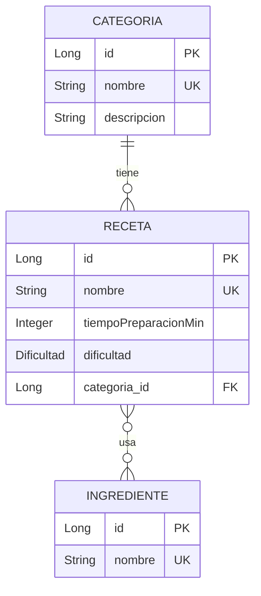

# 🍲 API de Gestión de Recetas

API REST desarrollada con **Spring Boot** para gestionar **categorías**, **recetas** e **ingredientes**. Proyecto de la unidad de Acceso a Datos / Programación de Servicios y Procesos (curso 2026-27).


## 📑 Índice

1. [Descripción](#-descripción)
2. [Tecnologías](#-tecnologías)
3. [Modelo de datos](#-modelo-de-datos)
4. [Cómo ejecutar el proyecto](#-cómo-ejecutar-el-proyecto)
5. [Documentación de la API (Swagger)](#-documentación-de-la-api-swagger)
6. [Endpoints](#-endpoints)
7. [Gestión de errores](#-gestión-de-errores)
8. [Validaciones](#-validaciones)
9. [Probar la API](#-probar-la-api)
10. [Estructura del proyecto](#-estructura-del-proyecto)
11. [Decisiones de diseño](#-decisiones-de-diseño)
12. [Flujo de trabajo](#-flujo-de-trabajo)
13. [Autor](#-autor)

## 📖 Descripción

La API permite:

- Gestionar **categorías** de recetas (CRUD completo).
- Gestionar **recetas** (CRUD completo). Cada receta pertenece a una categoría existente.
- Gestionar **ingredientes** (crear y listar).
- **Asociar ingredientes a recetas** (relación muchos a muchos) y consultar una receta con la lista de sus ingredientes.

## 🛠 Tecnologías

| Tecnología | Uso |
|---|---|
| Java 21 | Lenguaje |
| Spring Boot 4.1.1 | Framework (Web MVC) |
| Spring Data JPA / Hibernate | Persistencia |
| H2 | Base de datos (en fichero) |
| Bean Validation | Validación de entradas |
| springdoc-openapi 3.1.1 | Documentación OpenAPI 3.0 y Swagger UI |
| Lombok | Reducción de código repetitivo |
| Maven | Gestión de dependencias y construcción |

## 🗂 Modelo de datos



- **Categoría → Receta:** una categoría tiene muchas recetas (1:N). Cada receta tiene una categoría obligatoria.
- **Receta ↔ Ingrediente:** relación muchos a muchos (M:M), mediante la tabla intermedia `receta_ingrediente`.
- **Dificultad:** enumerado con los valores `FACIL`, `MEDIA` y `DIFICIL`.
- El `nombre` es único en las tres entidades.

## 🚀 Cómo ejecutar el proyecto

### Requisitos

- JDK 21
- No hace falta instalar Maven: el proyecto incluye el wrapper (`mvnw`).

### Pasos

```bash
git clone https://github.com/chema161/Proyecto-recetas.git
cd Proyecto-recetas/dam
```

En Windows:

```powershell
.\mvnw.cmd spring-boot:run
```

En Linux o macOS:

```bash
./mvnw spring-boot:run
```

La aplicación arranca en **http://localhost:8080**.

También puedes abrir la carpeta `dam` en IntelliJ IDEA y ejecutar la clase `DamApplication`.

### Base de datos

- Se usa **H2 en fichero** (`jdbc:h2:./db/basedatos`), que se crea en la carpeta `dam/db/`.
- `ddl-auto=create-drop`: **las tablas se recrean en cada arranque y los datos se pierden al parar la aplicación**.
- Consola H2: http://localhost:8080/h2-console
  - JDBC URL: `jdbc:h2:./db/basedatos`
  - Usuario: `sa`
  - Contraseña: *(vacía)*

## 📚 Documentación de la API (Swagger)

Con la aplicación en marcha:

| Recurso | URL |
|---|---|
| Swagger UI (interfaz interactiva) | http://localhost:8080/swagger-ui.html |
| Especificación OpenAPI (JSON) | http://localhost:8080/v3/api-docs |

Todos los endpoints están documentados con su descripción, ejemplos de cuerpo y **los códigos de respuesta posibles**, incluidos los endpoints de la relación M:M.

## 🔌 Endpoints

Ruta base: `/api/v1`

### Categorías

| Método | Ruta | Descripción | Respuestas |
|---|---|---|---|
| GET | `/categorias` | Listar categorías | 200 |
| GET | `/categorias/{id}` | Obtener una categoría | 200, 404 |
| POST | `/categorias` | Crear una categoría | 201, 400, 409 |
| PUT | `/categorias/{id}` | Editar una categoría | 200, 400, 404, 409 |
| DELETE | `/categorias/{id}` | Borrar una categoría | 204, 409 (si tiene recetas) |

### Recetas

| Método | Ruta | Descripción | Respuestas |
|---|---|---|---|
| GET | `/recetas` | Listar recetas (resumen) | 200 |
| GET | `/recetas/{id}` | Detalle de la receta **con sus ingredientes** | 200, 404 |
| POST | `/recetas` | Crear receta (requiere `categoriaId` existente) | 201, 400, 404 |
| PUT | `/recetas/{id}` | Editar una receta | 200, 400, 404 |
| DELETE | `/recetas/{id}` | Borrar una receta | 204 |

### Ingredientes

| Método | Ruta | Descripción | Respuestas |
|---|---|---|---|
| GET | `/ingredientes` | Listar ingredientes | 200 |
| POST | `/ingredientes` | Crear un ingrediente | 201, 400, 409 |

### Ingredientes de una receta (M:M)

| Método | Ruta | Descripción | Respuestas |
|---|---|---|---|
| POST | `/recetas/{recetaId}/ingredientes` | Añadir un ingrediente a una receta | 201, 400, 404, 409 |

> El `DELETE` es **idempotente**: si el recurso no existe, también responde `204`.

### Ejemplos

**Crear una receta**

```http
POST /api/v1/recetas
Content-Type: application/json

{
  "nombre": "Paella valenciana",
  "tiempoPreparacionMin": 90,
  "dificultad": "MEDIA",
  "categoriaId": 1
}
```

**Añadir un ingrediente a una receta**

```http
POST /api/v1/recetas/1/ingredientes
Content-Type: application/json

{
  "ingredienteId": 1
}
```

**Detalle de una receta** (`GET /api/v1/recetas/1`)

```json
{
  "id": 1,
  "nombre": "Paella valenciana",
  "tiempoPreparacionMin": 90,
  "dificultad": "MEDIA",
  "categoria": {
    "id": 1,
    "nombre": "Platos principales",
    "descripcion": "Comidas fuertes"
  },
  "ingredientes": [
    { "id": 1, "nombre": "Arroz bomba" }
  ]
}
```

## ⚠️ Gestión de errores

Todos los errores se devuelven con el formato estándar **ProblemDetail (RFC 7807)**, centralizados en un `GlobalExceptionHandler`.

| Excepción | Código | Cuándo se produce |
|---|---|---|
| `CategoriaNoEncontradaException` | **404** | La categoría no existe |
| `RecetaNoEncontradaException` | **404** | La receta no existe |
| `IngredienteNoEncontradaException` | **404** | El ingrediente no existe |
| `IngredienteYaAnadidoException` | **409** | La receta ya contiene ese ingrediente |
| `TiempoInvalidoException` | **400** | El tiempo de preparación es menor o igual a 0 |
| Validación (`@Valid`) | **400** | Datos de entrada inválidos |
| `DataIntegrityViolationException` | **409** | Nombre duplicado o recurso en uso |
| Cualquier otra | **500** | Error inesperado |

**Ejemplo de error de validación (400):**

```json
{
  "type": "https://recetas.example.com/errors/validacion",
  "title": "Datos de entrada inválidos",
  "status": 400,
  "detail": "Error de validación",
  "invalid-params": [
    {
      "object": "editRecetaDto",
      "message": "Ya existe una receta con ese nombre",
      "field": "nombre",
      "rejectedValue": "Paella valenciana"
    }
  ]
}
```

## ✅ Validaciones

- Anotaciones de Bean Validation en los DTOs de entrada: `@NotBlank`, `@NotNull`, `@Size`, `@Positive`.
- Los mensajes están **externalizados** en `src/main/resources/messages/errors.properties`.
- **Validación personalizada `@NombreRecetaUnico`:** comprueba que no exista otra receta con el mismo nombre. Al editar una receta, ignora la propia receta, de modo que conservar el nombre no cuenta como duplicado.
- El tiempo de preparación (`> 0`) se valida en el servicio y lanza `TiempoInvalidoException`.

## 🧪 Probar la API

El archivo [`dam/src/main/resources/test.http`](dam/src/main/resources/test.http) contiene **41 peticiones** documentadas y ordenadas por secciones:

0. Preparación (datos base)
1. Categorías
2. Ingredientes
3. Recetas
4. Ingredientes de una receta (M:M)
5. Borrados

Cada petición indica en su título el **código HTTP esperado** y lleva una comprobación automática (`client.test`) que se marca en verde o en rojo.

### Cómo usarlo

1. Arranca la aplicación.
2. Abre `test.http` en **IntelliJ IDEA** (cliente HTTP integrado).
3. Pulsa **Run all requests in file**, o ejecuta las peticiones de arriba abajo.

Los nombres llevan `{{$uuid}}`, así que las pruebas se pueden repetir sin reiniciar la aplicación.

> Este archivo sustituye a la colección de Postman, por indicación del profesor. Si prefieres usar Postman, importa `http://localhost:8080/v3/api-docs` y se generará la colección de todos los endpoints.

## 📁 Estructura del proyecto

```
Proyecto-recetas/
├── README.md
└── dam/
    ├── pom.xml
    └── src/main/
        ├── java/org/salesianostriana/dam/
        │   ├── DamApplication.java
        │   ├── config/        # Validación y OpenAPI
        │   ├── controller/    # Endpoints REST
        │   ├── dto/           # DTOs de entrada y salida (records)
        │   ├── error/         # Excepciones y GlobalExceptionHandler
        │   ├── model/         # Entidades JPA y enum Dificultad
        │   ├── repo/          # Repositorios Spring Data JPA
        │   ├── service/       # Lógica de negocio
        │   └── validation/    # Anotación @NombreRecetaUnico
        └── resources/
            ├── application.properties
            ├── messages/errors.properties
            └── test.http
```

**Capas:** `controller` recibe la petición y delega en `service`, que aplica las reglas de negocio y usa `repo`. Las entidades nunca se exponen directamente: se convierten a DTOs.

## 🧠 Decisiones de diseño

- **DTOs como `record`** y uno por intención de uso: `Edit...Dto` (crear/editar), `Get...ListDto` (listado) y `Get...DetailDto` (detalle). El detalle de receta **anida** el DTO de la categoría y la lista de DTOs de ingredientes.
- **409 para `IngredienteYaAnadidoException`:** es un conflicto con el estado actual del recurso, no un dato mal formado.
- **`@Getter/@Setter` en lugar de `@Data`** en las entidades, para evitar bucles de `hashCode`/`toString` en las relaciones bidireccionales.
- **Métodos `add...` en las entidades** para mantener sincronizados los dos lados de las relaciones.
- **Relación M:M simple:** no se ha implementado la mejora de cantidad y unidad de medida por ingrediente.

## 🔀 Flujo de trabajo

El desarrollo se ha organizado por historias de usuario, con **una rama y una Pull Request por funcionalidad**, y un tablero en GitHub Projects:

| Rama | Contenido |
|---|---|
| `01-modelos` | Entidades, relaciones y repositorios |
| `02-errores` | Excepciones y `GlobalExceptionHandler` |
| `03-categoria` | CRUD de categorías |
| `04-receta` | CRUD de recetas |
| `05-ingrediente` | Alta y listado de ingredientes |
| `06-receta-ingredientes` | Relación M:M |
| `07-validacion` | Validación personalizada y mensajes |
| `08-openapi` | Documentación OpenAPI/Swagger |
| `09-test-http` | Pruebas documentadas en `test.http` |
| `10-readme` | Este documento |

## 👤 Autor

**<Tu nombre completo>** · [@chema161](https://github.com/chema161)

Proyecto individual · Acceso a Datos y Programación de Servicios y Procesos · Curso 2026-27
